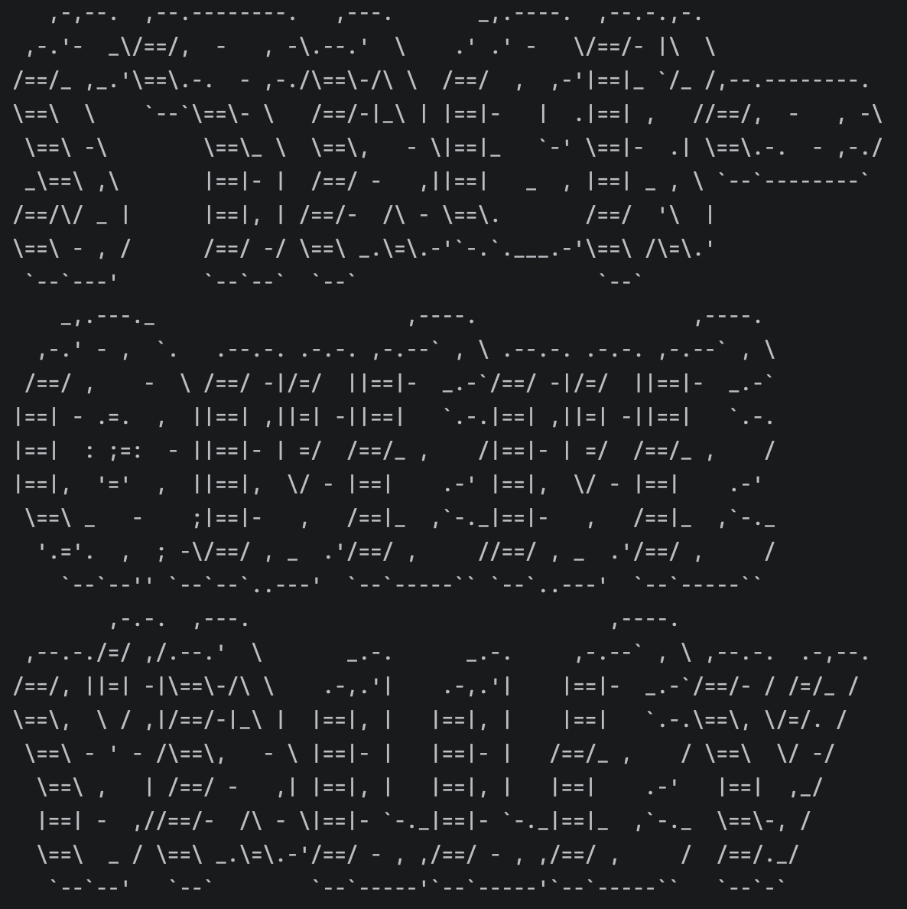

# Farm and Roguelike Game

[Open the notebook portfolio](https://xushuqing0575.github.io/#roguelike)

A farming game gets more interesting when the world does not stay put. This team Java project combines farming and trading with creatures, weather, disasters and recovery.

## My contribution

My contribution centred on trading-system and Second Spring features. The larger repository is team work, including the game engine and other mechanics; the features described below explain the surrounding architecture rather than claiming every class as my own.

## How the systems fit together

The project separates actors, actions, items, terrain, statuses and disaster behaviour. Recovery actions work through dedicated interfaces so a new effect can be introduced without rewriting every terrain type.

The weather component requests a seven-day forecast from Open-Meteo. It maps game locations onto coordinates and parses rainfall, temperature and wind values. Those values feed environmental mechanics. A forecast request can fail, so fetching and parsing belong behind a boundary separate from the action that applies an in-game effect.

## Design choices

Interfaces and polymorphism keep mechanics extensible. The single-responsibility principle is especially useful when separating a forecast client, an effect on the world and the action that recovers from that effect.

The shared project also contains creature state transitions. Those are team-level examples of the wider architecture, not individual contribution claims.

## Original development environment

The local Maven project targets Java 17. Its `pom.xml` declares JUnit Jupiter and Mockito for tests. The original team checkout uses `src/main/java`, `src/test` where available, and design documents under `docs`.

This repository is a public project writeup, not a complete redistribution of the team's game engine. It includes a portfolio notebook and the supplied title-screen image. Running the complete game requires the original team checkout and its supporting framework.

## What I would improve next

Make the forecast boundary easier to test with recorded responses, cover malformed or missing fields explicitly, and check that recovery behaviour remains consistent when several environmental effects overlap. These are proposed improvements, not claims of completed tests.

---
Chloe Shuqing Xu · [GitHub](https://github.com/xushuqing0575)
